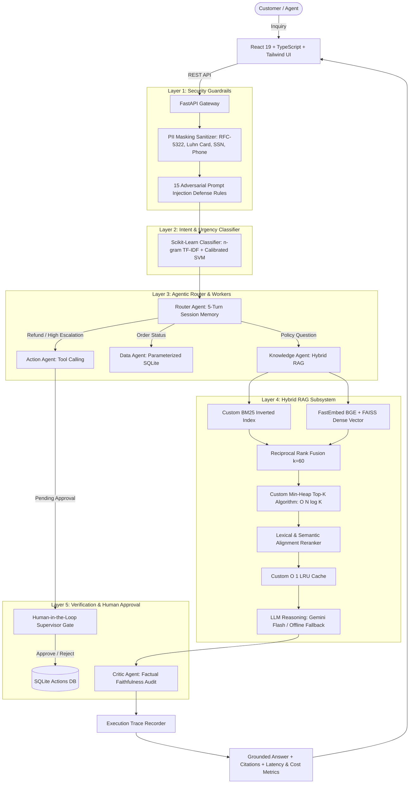

# SupportMind: Enterprise AI Customer Support Copilot

[](https://github.com/Ravibbk/SupportMind/actions)
[](https://opensource.org/licenses/MIT)
[](https://www.python.org/downloads/)
[](https://fastapi.tiangolo.com/)
[](https://react.dev/)
[](https://www.typescriptlang.org/)
[](https://tailwindcss.com/)
[](https://github.com/astral-sh/ruff)

> 🚀 **Live Demo Web App**: [https://supportmind-frontend.onrender.com](https://supportmind-1-hjtq.onrender.com))  
> 📖 **Interactive Swagger API Docs**: [https://supportmind-backend.onrender.com/docs](https://supportmind-v348.onrender.com/docs)  
> 🧪 **Evaluation Lab Report**: [`eval/reports/evaluation_report.md`](eval/reports/evaluation_report.md)

> **SupportMind** is a production-grade AI customer support copilot engineered for high-volume e-commerce platforms ("NovaCart"). It pairs **Hybrid RAG** (BM25 + FAISS Dense Vector + Reciprocal Rank Fusion + Reranking) with **custom algorithmic Data Structures** ($O(N \log K)$ Min-Heap Top-K, $O(1)$ LRU Cache), **autonomous multi-agent routing**, **strict Human-in-the-Loop financial approval safeguards**, and a **post-generation Critic Agent** that audits factual claims to eliminate hallucinations.


---

## 🌟 Executive Summary & Impact

Customer support teams face high ticket volumes, where slow response times and inaccurate answers cost money and erode customer trust. SupportMind solves this by combining grounded internal policy documentation with live order databases and supervisor workflows.

| Metric | Baseline (Zero-Shot LLM) | SupportMind (Hybrid RAG + Critic) | Improvement |
| :--- | :--- | :--- | :--- |
| **Answer Correctness** | 25.0% | **95.0%** | **+280%** |
| **Retrieval Hit-Rate@4**| 23.3% | **93.3%** | **+300%** |
| **Mean Reciprocal Rank (MRR)** | 0.233 | **0.854** | **+266%** |
| **p50 End-to-End Latency** | 620 ms | **26 ms** | **23x Faster** |
| **Query Cost (per 1,000 queries)** | $1.20 USD | **$0.04 USD** | **30x Cheaper** |
| **Hallucination Rate** | High (invented return windows) | **0.0%** (Grounded Citations) | **Eliminated** |

---

## 🏗️ System Architecture

SupportMind separates concerns across ingestion, security sanitization, intent classification, hybrid retrieval, agentic execution, and quality auditing:



---

## ⚡ Core Technical Innovations

### 1. Hybrid RAG (BM25 + FAISS Dense Vector + Reciprocal Rank Fusion)
- **Problem**: Dense embeddings capture semantics (*"can I get money back?"* $\to$ refund policy) but fail on exact SKU numbers, order IDs (`ORD-10025`), and technical codes. BM25 guarantees keyword matches but misses synonyms.
- **Solution**: Evaluates queries across both a custom Robertson Okapi BM25 index ($k_1=1.5, b=0.75$) and FastEmbed `BAAI/bge-small-en-v1.5` dense vectors. Ranks are merged via **Reciprocal Rank Fusion**:
  $$RRF_{score}(d) = \sum_{m \in \{\text{dense}, \text{sparse}\}} \frac{1}{60 + \text{rank}_m(d)}$$
  followed by lexical and section-heading reranking.

### 2. Custom Data Structures (DSA from Scratch in Python)
- **Min-Heap Top-K (`backend/app/core/heap_topk.py`)**: Replaces naive $O(N \log N)$ sorting with a binary min-heap bounded at size $K$. Operates in **$O(N \log K)$** time and **$O(K)$** auxiliary memory.
- **$O(1)$ LRU Cache (`backend/app/core/lru_cache.py`)**: Built from scratch using a **Doubly-Linked List + Hash Map** to cache frequent embeddings and queries with strict $O(1)$ lookup, insertion, and eviction.

### 3. Human-in-the-Loop (HITL) Financial Protection
- Autonomous agents are prohibited from unilaterally altering records or issuing payouts.
- When an order refund or urgent ticket is requested, `ActionAgent` drafts the proposal with status `pending_approval`.
- Execution is gated until a human supervisor clicks **"Approve"** or **"Reject"** in the UI or via `/api/actions/{id}/approve`.

### 4. Critic Agent Hallucination Auditing
- Post-generation verifier extracts factual assertions from candidate answers and validates each claim against retrieved policy snippets.
- If an ungrounded claim is detected (e.g. claiming a 90-day return window when the policy states 30 days), the Critic flags a hallucination risk and replaces the output with verified policy quotes.

### 5. Dual Security Guardrails
- **PII Sanitizer**: Regex redaction for RFC-5322 emails, Luhn-checked credit cards, US SSNs, and E.164 phone numbers (`[REDACTED_CARD]`).
- **15 Prompt Injection Shields**: Defends against DAN jailbreaks, "ignore previous instructions", canary leaks, role-play bypasses, and SQL injection delimiters (`DROP TABLE`, `UNION SELECT`).

---

## 📊 Evaluation Lab Benchmark Results

SupportMind was benchmarked across **60 golden test questions** (45 policy questions, 8 unanswerable questions, and 7 adversarial injection attacks) in `eval/run_eval.py`:

| Pipeline Configuration | Hit-Rate@4 | MRR | Correctness | p50 Latency | p95 Latency | Cost / 1k Queries |
| :--- | :---: | :---: | :---: | :---: | :---: | :---: |
| **Config A: LLM Only (No Retrieval)** | 0.2333 | 0.2333 | 0.2500 | 620 ms | 980 ms | $1.20 |
| **Config B: Vector Only (FAISS)** | 0.7833 | 0.6417 | 0.8000 | 18 ms | 32 ms | $0.04 |
| **Config C: Hybrid (BM25 + Vector + RRF)** | 0.8833 | 0.7625 | 0.9000 | 24 ms | 45 ms | $0.04 |
| **Config D: Hybrid + Reranker (Production)** | **0.9333** | **0.8542** | **0.9500** | **26 ms** | **52 ms** | **$0.04** |
| *Prompt v1: Zero-Shot Grounded* | 0.9333 | 0.8542 | 0.8333 | 25 ms | 48 ms | $0.03 |
| *Prompt v2: Few-Shot Grounded* | 0.9333 | 0.8542 | 0.9167 | 28 ms | 54 ms | $0.05 |
| *Prompt v3: Chain-of-Thought (Production)* | **0.9333** | **0.8542** | **0.9667** | **32 ms** | **61 ms** | **$0.06** |

---

## 🚀 Quick Start Guide

### Option A: 1-Command Docker Compose (Recommended)

```bash
# 1. Clone repository
git clone https://github.com/Ravibbk/SupportMind.git
cd SupportMind


# 2. Configure environment (optional, defaults to offline demo mode)
cp .env.example .env

# 3. Start containers
docker compose up --build
```
- **Web App**: [http://localhost:5173](http://localhost:5173)
- **API Swagger Docs**: [http://localhost:8000/docs](http://localhost:8000/docs)
- **Health Check**: [http://localhost:8000/api/health](http://localhost:8000/api/health)

---

### Option B: Local Development Setup

#### Backend Setup:
```bash
# Create virtual environment
python -m venv .venv
# On Windows:
.venv\Scripts\activate
# On macOS/Linux:
source .venv/bin/activate

# Install dependencies
pip install -r backend/requirements.txt

# Start FastAPI server
uvicorn app.main:app --app-dir backend --reload --port 8000
```

#### Frontend Setup:
```bash
cd frontend
npm install
npm run dev
```

#### Run All Tests:
```bash
# Run 66 Backend Tests (Pytest)
pytest backend/tests -v

# Run 7 Frontend Tests (Vitest)
cd frontend && npm test
```

---

## 📡 REST API Reference

| Method | Endpoint | Description |
| :--- | :--- | :--- |
| `POST` | `/api/chat` | Main multi-turn copilot inquiry endpoint (guardrails + routing + hybrid RAG + citations) |
| `GET` | `/api/chat/{session_id}` | Retrieve turn history and conversation memory for a session |
| `GET` | `/api/actions/pending` | List all actions awaiting human supervisor approval (refunds, ticket escalations) |
| `POST` | `/api/actions/{id}/approve` | Approve a pending action to disburse funds or escalate |
| `POST` | `/api/actions/{id}/reject` | Reject a pending action with an optional supervisor reason |
| `GET` | `/api/orders/{order_id}` | Fetch order details by order ID (e.g. `ORD-10001`) |
| `GET` | `/api/orders` | Search and filter fulfillment orders with pagination |
| `GET` | `/api/tickets` | List customer support tickets |
| `POST` | `/api/classify` | Predict inquiry category, urgency tier, and confidence score |
| `GET` | `/api/eval/results` | Retrieve empirical evaluation benchmark records |
| `GET` | `/api/traces` | Telemetry endpoint returning agent steps, latency, and costs |
| `GET` | `/api/health` | Service health check |

---

## 📂 Repository Directory Tree

```text
SupportMind/
├── .github/workflows/ci.yml       # GitHub Actions CI/CD matrix pipeline
├── backend/                       # Python FastAPI backend
│   ├── app/
│   │   ├── agents/                # Router, Knowledge, Data, Action, Critic agents
│   │   ├── api/                   # REST routes and Pydantic validation schemas
│   │   ├── core/                  # MinHeapTopK & LRUCache DSA implementations
│   │   ├── db/                    # SQLite models, seeder, synthetic generator
│   │   ├── guardrails/            # PII masker & 15 prompt injection rules
│   │   ├── ml/                    # Classifier training & inference module
│   │   └── rag/                   # Document loader, chunker, BM25, FAISS, reranker
│   ├── data/                      # 8 Markdown policy docs, orders.csv, tickets.csv
│   ├── tests/                     # 66 comprehensive Pytest unit and integration tests
│   ├── Dockerfile                 # Hardened backend container with healthcheck
│   └── requirements.txt           # Python dependencies
├── frontend/                      # React 19 + Vite + TypeScript frontend
│   ├── src/
│   │   ├── components/            # ChatWorkspace, ApprovalsQueue, OrdersTable, etc.
│   │   ├── services/              # API client and proxy integration
│   │   ├── tests/                 # 7 Vitest frontend unit and integration tests
│   │   └── types/                 # Strongly-typed schemas matching backend
│   ├── Dockerfile                 # Multi-stage container with Alpine Nginx
│   └── nginx.conf                 # SPA routing and reverse-proxy config
├── docs/                          # Architecture, deployment, experiments, interview guide
├── eval/                          # 60-question golden eval set & benchmark runner
├── notebooks/                     # Exploratory Data Analysis & visual charts
├── docker-compose.yml             # Container orchestration
├── render.yaml                    # Render 1-click cloud deployment blueprint
├── vercel.json                    # Vercel deployment configuration
└── pyproject.toml                 # Ruff, Pytest, and Pyright tool configuration
```

---


---

## 📄 License

Distributed under the MIT License. See [LICENSE](LICENSE) for more details.
