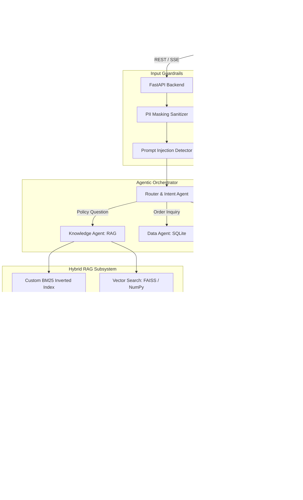

# SupportMind: Production AI Customer Support Copilot

[](https://github.com/placeholder-user/supportmind/actions)
[](https://opensource.org/licenses/MIT)
[](https://www.python.org/downloads/)
[](https://react.dev/)
[](https://fastapi.tiangolo.com/)

> **SupportMind** is an enterprise-grade AI customer support copilot designed for e-commerce ("NovaCart"). It provides hybrid RAG document search with precise snippet citations, agentic orchestration with human-in-the-loop approvals, PII masking and prompt-injection guardrails, custom DSA retrieval algorithms, and automated LLM-as-a-judge evaluation benchmarks.

---

## Architecture Overview



---

## Key Features

- **Hybrid RAG Retrieval**: Combines scratch-built BM25 inverted index with fastembed dense embeddings via Reciprocal Rank Fusion (RRF) and custom min-heap top-k selection.
- **Strict Grounding & Citations**: LLM responses are strictly grounded in policy docs with file name, section, and exact quoted snippets; flags unanswerable queries cleanly.
- **Agentic Tool Calling & Human-in-the-Loop**: Executes structured tools (order lookup, ticket creation, refund requests). Financial and ticket actions require human approval (Approve/Reject).
- **Critic Agent Verification**: Post-generation hallucination and faithfulness auditor verifies claims against retrieved chunks.
- **Zero-Trust Guardrails**: Regex and rule-based PII masking for emails, credit cards, and phone numbers, plus adversarial prompt-injection shields.
- **Evaluation Lab**: Rigorous 60-query benchmark measuring Retrieval Hit-Rate@K, MRR, LLM-as-a-judge correctness, faithfulness, latency, and token cost.
- **Premium Frontend Experience**: Dark/light mode, citation side drawer, interactive approval cards, real-time agent execution traces, and Evaluation Lab dashboards.

---

## Tech Stack

| Layer | Technology |
|---|---|
| **Backend** | Python 3.11+, FastAPI, Pydantic v2, Uvicorn |
| **LLM Provider** | Google Gemini API (`google-genai` SDK), swappable provider interface |
| **Embeddings & Vector** | FastEmbed (`BAAI/bge-small-en-v1.5`), FAISS CPU with plain-NumPy fallback |
| **Search & DSA** | Custom BM25 Inverted Index, Reciprocal Rank Fusion, Custom Min-Heap Top-K, Custom LRU Cache |
| **Machine Learning** | Scikit-learn (TF-IDF + Logistic Regression / Linear SVM), Pandas, NumPy |
| **Database** | SQLite (Orders, Tickets, Trace logs) with parameterized queries |
| **Frontend** | React 18, Vite, TypeScript, Tailwind CSS, Framer Motion, Recharts, Lucide Icons |
| **DevOps & Testing** | Docker, Docker Compose, GitHub Actions, Pytest, Ruff |

---

## Quick Start (Local Development)

### Prerequisites
- Python 3.11+
- Node.js 18+
- Git

### 1. Backend Setup
```bash
# Clone the repository
git clone https://github.com/placeholder-user/supportmind.git
cd supportmind

# Create and activate virtual environment
python -m venv .venv
source .venv/bin/activate  # On Windows: .venv\Scripts\activate

# Install dependencies
pip install -r backend/requirements.txt

# Configure environment
cp .env.example .env
# Edit .env and supply GEMINI_API_KEY (or leave DEMO_MODE=true)

# Start backend
uvicorn app.main:app --app-dir backend --reload --port 8000
```

### 2. Frontend Setup
```bash
cd frontend
npm install
npm run dev
```

Visit `http://localhost:5173` for the web UI and `http://localhost:8000/docs` for the interactive OpenAPI documentation.

---

## License
MIT License. See [LICENSE](LICENSE) for details.
